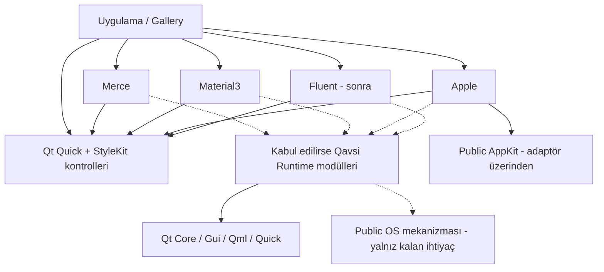
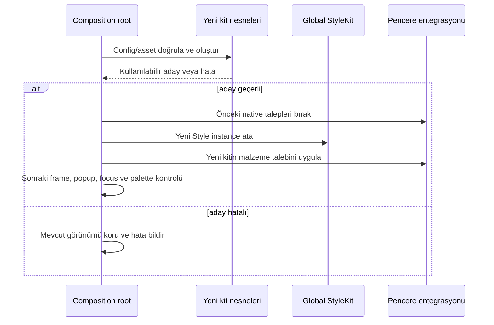

# Qavsi mimari tasarımı
**Durum:** Öneri / inceleme taslağı\
**Tarih:** 2026-10-23; altı alanlı inceleme 2026-10-24; kaynak düzeltmesi 2026-10-25\
**Hedef:** Qt 6.12+, C++20, CMake 3.30+\
**Belgeleme düzeni:** arc42’nin 12 görünümünden uyarlanmıştır; [resmi şablon](https://arc42.org/overview/) esas alınmıştır.

Bu belge uygulanmış bir framework’ü anlatmaz. “Olmalı / yapılır” ifadeleri önerilen sözleşmedir; kaynak incelemesiyle doğrulanan gerçekler ayrıca kaynaklandırılır. Mevcut Merce API’si kendiliğinden değişmiş sayılmaz.

## 1. Amaç, kullanıcı ve kalite hedefleri

### 1.1 Ürün konumu

Qavsi, Qt Quick için bağımsız tasarım sistemlerinin birlikte geliştirilebildiği bir ekosistemdir. Runtime, bütün kitlere aynı görünümü veren bir üst tasarım sistemi değildir.

Dört farklı kavram ayrılır:

| Kavram | Örnek | Sahibi |
|---|---|---|
| Tasarım sistemi | Merce, Material3, Apple, Fluent | İlgili kit |
| Tema | Light/Dark/System, marka veya renk üretim girdisi | İlgili kit |
| Kullanım bağlamı | Pointer/touch tercihi, uygulamanın kiosk gereksinimi | Uygulama; kit bunun görsel karşılığını belirler |
| Platform yeteneği | Native cam varlığı, renderer, OS motion tercihi | Önce public Qt; kalan OS köprüsü kit/projede |

Merce’nin `ops/cart` profilleri diğer kitlerin ölçeğine çevrilmez. Uygulama büyük dokunma hedefleri istiyorsa bunu her kitin desteklediği yolla ifade eder. Bütün kitlerde aynı piksel değerini veya aynı profil adını zorunlu tutmayız.

### 1.2 Kullanıcılar

- Yalnız bir ikon sağlayıcısı isteyen Qt Quick geliştiricisi.
- Kendi uygulamasına Material3 görünümü eklemek isteyen geliştirici.
- Merce marka ve kiosk profillerini kullanmak isteyen ürün ekibi.
- Apple native malzemeleriyle Qt Quick uygulaması geliştiren masaüstü ekibi.
- Bağımsız bir tasarım sistemini Qavsi ekosistemine ekleyen üçüncü taraf geliştirici.

### 1.3 Öncelikli kalite hedefleri

1. **Bağımsızlık:** Material3, Merce kapalı veya kurulu değilken derlenir ve çalışır.
2. **Doğru native davranış:** Klavye, focus, Action, erişilebilirlik, popup ve IME Qt tarafından yürütülür.
3. **Dağıtılabilirlik:** Kaynaktan ve kurulu paketten tüketim aynı public target’ları sunar.
4. **Görsel doğruluk:** Her kit kendi tasarım kuralları ve token’larına göre değerlendirilir.
5. **Kaynak kontrollü çalışma:** Software renderer, EGLFS/offscreen gibi bağlamlarda okunaklı fallback bulunur.
6. **Açık kapsam:** Experimental API, desteklenmeyen Qt davranışı ve ölçülmemiş performans açıkça işaretlenir.

### 1.4 Kapsam dışında

Bir masaüstü kabuğu, compositor, pencere yöneticisi, genel servis yöneticisi, gRPC altyapısı, süreç çalıştırma çatısı veya Qt Quick Controls yerine yeni kontrol kütüphanesi geliştirilmeyecek. Qt for MCUs ve ESP-IDF, tam Qt 6.12/StyleKit ile aynı hedef kabul edilmeyecek.

## 2. Kısıtlar

| Konu | Karar / sınır |
|---|---|
| Qt | Minimum 6.12; ilk doğrulama 6.12.0 üzerinde |
| C++ | C++20; public target compile feature’ı üzerinden |
| CMake | 3.30+; target tabanlı bağımlılıklar |
| StyleKit | Technology preview; sürüm yükseltmesi otomatik uyumluluk anlamına gelmez |
| SDK | Kurulu SDK’ya yama uygulanmaz |
| Kontroller | Mevcut MButton taşınma sırasında korunur |
| Bağımlılıklar | KDE, Quickshell ve QWindowKit zorunlu runtime bağımlılığı değildir |
| Public API | Qt private C++ header’ları ve `Qt.labs.StyleKit.impl` yeni public sözleşmeye sızmaz |
| Token | Üretilmiş dosyalar elle düzenlenmez; her kit kendi kaynaklarının sahibidir |
| Ortak yapı | Önce mevcut public Qt/standart çözüm; yalnız gerekli ve kanıtlanmış ortak mekanizma Qavsi’ye alınır |
| Tasarım girdisi | Material3: resmi Google; Fluent: resmi Microsoft; Apple: native Liquid Glass için HIG/public AppKit. Kit başına DESIGN.md; VoltAgent web dosyası yardımcı, eski girdiler tarihsel |
| UI doğrulaması | İnsanla yapılan masaüstü kontrolleri yalnız sol monitörde; otomasyon mümkünse foreground kullanmaz |
| Mevcut Git | Merce’deki ilgisiz değişikliklere, branch’e ve commit geçmişine dokunulmaz |

StyleKit’in public QML modülünü kullanmak ile `impl` tipine bağımlı olmak aynı şey değildir. Public Labs API bile sürüm riski taşır; private kullanım ayrıca izole edilmelidir. [Qt StyleKit](https://doc.qt.io/qt-6/qml-qt-labs-stylekit-stylekit.html)

## 3. Sistem bağlamı



Ok bağımlılık yönünü gösterir. Tasarım sistemleri arasında yatay bağımlılık yoktur. Runtime hiçbir kitin token, Theme veya Style modülünü import etmez.

Runtime okları zorunlu dependency değildir. İlk bağımsız kit yalnız Qt + kendi Theme/Style ile başlayabilir. Altı alanlı incelemenin ortaklık değerlendirmesinde henüz bütün kabul kapılarını geçen yeni bir Runtime component’i bulunmadı; [04 raporu](reviews/04-shared-boundary.md). Bu nedenle boş bir Runtime deposu/target’ı açılmaz.

Uygulama iş mantığını ve veriyi tutar. Bir input’un validasyonunun ne zaman çalışacağı, bir kaydetme işinin iptal edilmesi veya bir navigation hedefinin iş izni kit tarafından belirlenmez.

Qavsi’nin dış sınırları: Qt API’leri, public OS API’leri, CMake paket tüketicisi, tasarım token kaynakları ve güvenilir ikon paketleri. Dışarıdan yüklenen bir QML dosyası “tema verisi” değil, çalıştırılabilir uygulama kodudur.

## 4. Çözüm stratejisi

### 4.1 KDE’den alınan ve alınmayan fikir

KDE/Kirigami’den platform entegrasyonunun ayrı modül olması, public/private ayrımı, kurulu paket tüketicisi kontrolü ve büyük uygulama yapı taşlarının davranış/yerleşim olarak ayrılması alınır.

Kirigami’nin `Theme` / `Units` sözlüğü Qavsi’nin evrensel token modeli yapılmaz. Kirigami kendi tasarım ve platform yaklaşımı olan bir framework’tür. KDE Frameworks sürümleme ve dağıtım deneyimi örnektir; ECM veya KDE modülleri zorunlu bağımlılık olmaz. İncelenen KirigamiPlatform kaynağı private Qt bağımlılığı da taşır; bu ayrıntıyı kopyalamayız. [Kaynak incelemesi](docs/RESEARCH.md)

### 4.2 Quickshell’den alınan ve alınmayan fikir

Özelliğe göre QML namespace’leri, isteğe bağlı platform modülleri ve açık QObject/engine yaşam döngüsü örnek alınır.

Quickshell bir Linux masaüstü kabuğu toolkit’idir. Kendi executable’ı, engine generation ve reload protokolü vardır. Bu mimariyi bir UI kütüphanesine taşımak yeni bir runtime motoru üretir. Qavsi bunu yapmaz; geliştirme için Qt QML Preview ve uygulamanın mevcut QQmlEngine’i kullanılır.

Quickshell kaynaklarında reload, yeni engine/generation oluşturup belirli nesnelerden durum aktarma yaklaşımıyla ele alınır. “Bütün QML state’i kendiliğinden korunur” iddiasına dayanmayız. [İncelenen kaynaklar](docs/RESEARCH.md)

### 4.3 Tasarım sistemleri eş düzeydir

Her kit doğrudan `SK.Style` temelinden başlar. Ortak büyük bir `QavsiBaseStyle` üretilmez.

Örnek: Material3’ün `primaryContainer`, elevation ve type-scale rolleri kendi modelinde kalır; Merce’nin `colors.action.primary.container` rolüne zorunlu çevrilmez. Apple’ın platform malzeme seçimi de Fluent’in materyal veya renk rolleriyle tek enum içinde eşitlenmez.

İki kit aynı saf algoritmaya ihtiyaç duyarsa önce mevcut Qt API’si kullanılır. Standartlık, Qt boşluğu, aynı sözleşme, gerçek tüketim, ownership/fallback ve dağıtım kapıları birlikte geçilirse küçük mekanizma Runtime’a çıkarılabilir. Yalnız iki tüketici veya benzer görünüm ortaklaştırma gerekçesi değildir.

### 4.4 Seçenekler ve bedeller

| Seçenek | Kazanç | Bedel / neden seçilmedi |
|---|---|---|
| MerceStyle’dan türeyen tüm stiller | En az ilk taşıma işi | Merce token ve varsayımlarına kalıcı bağımlılık |
| Tek monorepo, bağımsız paketler | Tek CI ve atomik değişiklik | Bağımsız yayın ve sahiplik daha az görünür |
| **Organizasyon + bağımsız depolar** | Net paket sınırı ve sürümleme | Entegrasyon/uyumluluk matrisi ayrıca yönetilir |
| Her küçük modüle ayrı repo | En küçük yayın birimi | Başlangıçta gereksiz koordinasyon yükü |

Öneri: her tasarım sistemi ayrı depo; Gallery bağımsız tüketici; mimari belgeler ayrı `qavsi` merkezinde. Ortak mekanizma bütün kabul kapılarını geçtiğinde Runtime deposu içinde seçilebilir target/QML modülü olur. Runtime ilk kitin zorunlu başlangıç bağımlılığı değildir.

### 4.5 Mevcut tasarım girdisi yeterli bir üretim standardı değildir

Kullanıcı Material3’te resmi Google, Fluent’te resmi Microsoft rehberlerini esas aldı; Apple native Liquid Glass hedefini korudu. Kaynak edisyonu/platformu ve sapmalar kitte izlenir. Material3 klasik/Expressive, Fluent Web/WinUI ve Apple web/native HIG tarifleri karıştırılmaz. VoltAgent Apple web dosyası yardımcı, eski katalog snapshot’ları tarihsel girdidir. [Kabul edilen kaynaklar](references/SOURCES.md), [kit kaynak sürümü sözleşmesi](docs/KIT-AUTHORING.md#11-kaynak-sürümü-ve-sapma-kaydı)

Public StyleKit sınırsız bir renderer API’si değildir. TextStyle tam typography/line-height recipe’si taşımaz; family QFont girdisiyle çözülebilen alt küme ve gerekirse kit içi açık content adaptörü ayrılır. Kaynak recipe’sinin kendi generated çıktısıyla eşleşmesi resmi tasarım doğruluğunu kanıtlamaz. Material3 için ilk bağımsız Small buton bu sınırlarla başlar. [01 incelemesi](reviews/01-material3.md)

Fluent’te önce Qt’nin hazır FluentWinUI3 stili değerlendirilir. Yeni StyleKit kiti ancak public kit recipe/extension ve root Style geçişi gibi karşılanmayan ihtiyacı varsa yapılır. Qt stilinin image/palette uygulaması veya bir CSS blur token’ı native Windows Mica/Acrylic desteği değildir. [03 incelemesi](reviews/03-fluent.md)

## 5. Yapı taşları

### 5.1 GitHub ve yerel çalışma düzeni

GitHub organizasyonu [Qavsi](https://github.com/Qavsi), 2026-10-25 tarihinde
kullanıcı tarafından oluşturuldu ve GitHub API ile doğrulandı. İlk repo sınırları
[başlangıç planında](docs/REPOSITORIES.md) kayıtlıdır. Yerel `qavsi/` yalnız çalışma klasörüdür:

```text
qavsi/
├── qavsi/              # mimari ve karar kayıtları
├── runtime/            # kabul edilmiş ortak mekanizma oluştuğunda
├── merce/              # Merce tasarım sistemi
├── material3/          # Material3 tasarım sistemi
├── apple/              # Apple tasarım sistemi
├── gallery/            # ortak tüketici
└── fluent/             # çalışma başladığında
```

Üst klasöre Git initialize edilmez. Gizli nested repo veya zorunlu submodule düzeni kurulmaz. Bir kit tek başına clone edilip bağımlılıkları kurulu prefix’ten bulunabilmelidir.

### 5.2 Runtime modülleri

Bu tablo aday kataloğudur; URI/target adlarının yazılması ortak modülün kabulü değildir. [Standartlık ve gereklilik kapısı](docs/SHARED-ADMISSION.md) geçmeyen yapı kit/uygulamada kalır. Qt’nin doğrudan sunduğu mekanizma Qavsi wrapper’ı olarak yeniden yayımlanmaz.

**Bugünkü sınıflandırma:** Qt’nin temel SF/font ikonları, native menü, motion/contrast ve window/renderer olguları doğrudan Qt’de. Paketli multi-collection/ikon başına eksen, birleşik ButtonSupport, eksik OS tercihleri ve native material bridge henüz `DEFER`; mevcut projelerinde kalır. Materyalin public AppKit olması, Apple/Fluent arasında ortak bir malzeme semantiği kanıtlamaz. [Bileşen bazlı kanıt ve tablo](reviews/04-shared-boundary.md)

| Modül | İçerik | Görsel politika içerir mi? |
|---|---|---|
| `Qavsi.Icons` | AppIcon, paket çözümleme, image/native/provider yönlendirme | Yalnız çizim mekanizması; renk/boyut token’ı yok |
| `Qavsi.Icons.Material` | Material font ve metadata sağlayıcısı | Font eksenleri; seçili durum politikası yok |
| `Qavsi.Icons.FontAwesome` | Mevcut SVG/collection sağlayıcısı | Paket kendi çizim biçimini korur |
| `Qavsi.Icons.SFSymbols` | Ancak Qt’nin karşılamadığı ileri native ihtiyacı kanıtlanırsa aday | Temel native lookup/render için Qt kullanılır |
| `Qavsi.ButtonSupport` | Loading state, enabled guard, destek içerik adaptörü | Kitin verdiği çözümlenmiş görsel girdileri kullanır |
| `Qavsi.Platform` | Yalnız Qt’de bulunmayan ve kapıyı geçen dar OS ihtiyacı; genel facade değil | Qt motion/contrast/window/renderer API’leri tekrar paketlenmez |
| `Qavsi.Platform.Materials` | Native malzeme talebini uygulayan opsiyonel adaptör | Mekanizma; fallback renkleri kitte |
| `Qavsi.Platform.Menus` | Gösterilmiş Qt açığı olmadan açılmayacak aday | Önce Qt Menu native/QML yolu; form ComboBox ayrı |

Materials veya Menus kapıyı geçerse bağımsız optional target olabilir; bugün kabul edilmiş değiller. İhtiyaç kanıtlanmadan genel eklenti fabrikası kurulmaz. Ortak `Effects` veya `Notifications` modülü başlangıç varsayımı değildir. Merce’deki mevcut efekt/feedback kodu, bağımsız sözleşmesi kanıtlanana kadar Merce’de kalır.

### 5.3 Kit yapısı

```text
material3/
├── CMakeLists.txt
├── cmake/
├── DESIGN.md
├── tokens/                         # kitin kendi şeması
├── generated/                      # build çıktısı mı committed mı: kit politikası
├── tools/tokens/                   # build-time; tüketici için zorunlu değil
├── src/Qavsi/Material3/
│   ├── Theme/
│   └── Style/
│       ├── Material3Style.qml
│       └── internal/
│           ├── actions/
│           │   ├── themes/
│           │   ├── variations/
│           │   └── delegates/
│           ├── inputs/
│           ├── selection/
│           ├── navigation/
│           └── surfaces/
├── tests/
│   ├── contracts/
│   ├── rendering/
│   └── installed-consumer/
└── examples/minimal/
```

Public URI’nin fiziksel dizinle eşleşmesi tercih edilir. Internal alt klasörler ayrıca public QML modülü değildir. Her family’nin theme/state mapping, variation ve renderer’ı yan yana bulunur; tek dev QML dosyası veya her satıra ayrı component üretilmez.

Her kitin `DESIGN.md` dosyası o kitin görsel sözleşmesini tutar. Ortak `AGENTS.md` mimari, derleme, test ve sahiplik kurallarını tutabilir; bütün kitlere aynı spacing/color kurallarını dayatamaz.

Güncel sözleşmeler [Material3](design-systems/material3/DESIGN.md), [Fluent](design-systems/fluent/DESIGN.md), [Apple native Liquid Glass](design-systems/apple/DESIGN.md) altındadır; bağımsız kit repo’sunda kök DESIGN.md’ye taşınırlar. Bunlar Qavsi uyarlama metinleridir, resmi kuruluşların yayımladığı DESIGN.md kopyaları değildir. Kaynak snapshot’ları [ayrı statü/hash’lerle](references/SOURCES.md) korunur. Merce’nin DESIGN.md’si diğer kitleri sınırlayan ortak sözleşmeye dönüşmez.

### 5.4 Token sahipliği

Ortaklaştırılabilecek şey dosya biçimi, alias doğrulama veya üretim aracı olabilir; token isimleri ve anlamları değildir. DTCG bir değişim biçimidir, evrensel tasarım sistemi değildir. Kullanılırsa yayımlanmış 2025.10 sürümü sabitlenir; hareketli draft normatif kaynak olmaz. [DTCG formatı](https://www.designtokens.org/TR/2025.10/format/)

Kit, kaynak token → doğrulama → çözülmüş değerler → typed Theme/recipe → StyleKit mapping zincirinin sahibidir. Normal tüketici build’i Node/npm veya tasarım araçları gerektirmez.

Apple’da OS tarafından sağlanan malzeme/renk/font bilgisi, kopyalanmış sabit bir JSON paletinin yerini alabilir. Her platform değerini token dosyasına dondurmaya çalışmayız.

### 5.5 Gallery

Gallery; ürün iş mantığı, örneklerin yerleşimi, ortak örnek isimleri ve screenshot senaryolarının sahibidir. Library API’si değildir.

Tek süreçli kullanımda stil seçimi bir composition root’ta yapılır. Eşzamanlı karşılaştırma için kit başına ayrı worker executable süreci başlatılır. Basit `--kit material3 --mode dark --scenario buttons` girdileri kullanılır; erken aşamada RPC framework veya özel IPC protokolü gerekmez. Canlı etkileşim her worker’da kendi native penceresinde yapılır. Sonuçlar ve capture dosyaları ortak raporda eşleştirilir.

## 6. Çalışma senaryoları

Yeni kitin uçtan uca geliştirici akışı, Gallery root adaptörü ve dışarıdan özelleştirme yolları [KIT-AUTHORING](docs/KIT-AUTHORING.md) içindedir.

### 6.1 Uygulama başlangıcı

1. Uygulama yalnız gerekli kit target’ını; varsa kabul edilmiş ve kullandığı Runtime component’ini bağlar.
2. Qt’nin base control style seçimi gerekiyorsa engine’den önce yapılır; ürünün esas görünümü SK.Style ile atanır.
3. Kit Theme/config nesnesi oluşturulur; kaynak doğrulaması başarısızsa son geçerli veya gömülü kit varsayılanı kullanılır.
4. `StyleKit.style` root’ta, child control’lerden önce atanır.
5. Native pencere entegrasyonu isteniyorsa tek owner belirlenir.
6. Kontroller Qt davranışları ve kitin çözülmüş görsel değerleriyle oluşur.

Qavsi otomatik QGuiApplication veya QQmlEngine oluşturmaz. Uygulama başlatma ayarlarını kütüphane import edildi diye değiştirmez.

### 6.2 Runtime stil değişimi



Bu akış bir hedef sözleşmedir; Qt atomik bir “stil transaction” API’si sağlamıyor. Birden çok state/surface’in tek frame’de değişmesi ayrıca test edilir. İş nesneleri ve native kontrol instance’ları stil seçimi yüzünden yeniden yaratılmaz.

Qt bug’ı süresince Gallery karşılaştırma sayfaları sabit `gallery.*` instance rolleri kullanır; kit adaptörleri bu rolleri stil kurulurken tanımlar. Kit değişimi mevcut kontrolün variation listesini değiştirmez. Native kit rollerine birebir eşdeğer olmayan örnekler ayrı senaryoda/worker’da açılır. Ayrıntı [KIT-AUTHORING](docs/KIT-AUTHORING.md) içindedir.

[05 proof’u](reviews/05-stylekit-runtime.md) aynı SK.Button üzerinde sabit rol, light/dark, normal/hover/checked ve A→B→A stil geçişi için 399 assertion’ı geçirdi. Bu temel mekanik kanıttır; gerçek kit content’leri, typography override’ları, açık popup/IME veya tek-frame atomik geçiş henüz doğrulanmadı. Bilinen variation mutation örneği beklenen şekilde hâlâ başarısız.

`style` ve `styleUrl` yolları aynı host’ta karıştırılmaz. Qt 6.12.0 kaynaklarında styleUrl ile oluşturulan nesnenin sahipliği ayrıca izleniyor. Başlangıç için uygulamanın sahip olduğu Style instance yolu seçilir. Null Style ataması veya engine silip yeniden açma bir reset çözümü olarak kullanılmaz.

### 6.3 Global stil sınırı — kritik

Qt 6.12.0 `QQStyleKitAttached::s_instance` statiktir ve QGuiApplication’a parent edilir. Başka bir window’dan veya engine’den erişim aynı global stili verir. Bu yalnız dokümandaki “singleton” ifadesinden çıkarım değil, kaynakta doğrulanan davranıştır. [Qt 6.12.0 kaynak](https://github.com/qt/qtdeclarative/blob/4332fbbb4c340463dc8cee36dda0c85d932122d8/src/labs/stylekit/qqstylekit.cpp#L90)

Sonuçlar:

- Aynı uygulamadaki bütün SK kontrolleri tek aktif tasarım sistemini izler.
- Kit Theme nesnelerini scoped tasarlamak, StyleKit’in bu kapsamını değiştirmez.
- İki QQmlEngine ile iki bağımsız SK görünümü vaat edilmez.
- Gallery’nin yan yana çalışan worker’ları ayrı süreçtir.
- Üretimde pencere başına farklı sistem gerekiyorsa bu v1 kapsamı dışıdır; ayrı Qt tasarımı gerekir.
- Qt yükseltmesinde bu sınır yeniden doğrulanır.

V1’de tek ana QQmlEngine stil host’udur ve app-owned Style nesnelerinden uzun yaşar. Global Style QObject’ini farklı engine’ler arasında yeniden sahiplenme, ilk engine’i silip başka engine’le devam etme veya native provider QObject’ini engine’ler arasında paylaşma desteklenen lifecycle değildir.

### 6.4 Tema ve marka değişimi

Kitin kendi Theme/config API’si kullanılır. Material3 config’i Merce Theme singleton’ına yazmaz. Erişilebilirlik gibi ortak OS olguları okunur; kit bunların görsel karşılığını uygular.

Config/manifest önce bütünüyle doğrulanır, sonra yayımlanır. Eksik alanlar, alias döngüsü, NaN boyut veya okunamayan font yarım tema uygulanmasına yol açmaz. Başarısız yüklemede mevcut geçerli bağlam korunur. Kullanıcı dosyasını uygulama adına sessizce yeniden yazmayız.

### 6.5 Loading

ButtonSupport mevcut butonu korur. Loading başlayınca yalnız o butonun aktivasyonu engellenir. Bittiğinde caller’ın enabled binding’i geri gelir ve güncel bağımlılıkları hesaplar. İş state’i, başka Action/shortcut üzerinden tekrar çağrı ve backend idempotency uygulamaya aittir.

Metin/ikon/spinner görünümü, genişlik rezervi ve erişilebilirlik ayrıntıları [kontrol sözleşmesindedir](docs/CONTRACTS.md).

### 6.6 Native malzemenin kaybı

Window handle, ekran, renderer veya OS erişilebilirlik tercihi değişince malzeme desteği yeniden değerlendirilir. Destek yoksa native view’lar ayrılır ve kitin opak fallback’i etkin kalır. QML içeriği görünmez/okunmaz bırakılmaz. Destek bilgisinin henüz hazır olmadığı başlangıçta da aynı güvenli görsel yol kullanılır.

Native view’ın mekanik attach’i HIG veya görsel okunaklılık başarısı değildir. Mevcut Apple bridge’de glass contentView ile ayrı Qt foreground’un composition sınırı ve birden fazla window-state owner riski var. Yeni dilimde public winId/PlatformSurface yaşam döngüsü, tek owner, basit geometri ve gerçek masaüstü üzerinde tek regular yüzey önce geçer; Qt Metal root’u yeniden sahiplenilmez. [02 incelemesi](reviews/02-apple.md)

Native cam → software geçişi aynı süreçte backend değiştirme vaadi değildir. Backend başlangıçta seçilir; ayrı çalıştırmalarla test edilir. Runtime koşul değişimleri ise mevcut backend üzerinde ele alınır.

### 6.7 Geliştirme sırasında reload

QML Preview yalnız Debug/özel development build’lerinde kullanılır. QML/JS değişikliği, C++ tipi/ABI değişikliği ve üretilmiş QML metadata değişikliği farklı işlemlerdir; son ikisi rebuild/restart gerektirebilir.

Reload’un bütün state’i koruduğu varsayılmaz. İş verisi servis/model katmanında, UI’den bağımsız tutulur. Native observer, event filter ve material view nesnelerinin eski generation sonrasında kaldığı ayrıca kontrol edilir. Geliştirme aracı Runtime bağımlılığı veya CI zorunluluğu olmaz. [Qt qmlpreview](https://doc.qt.io/qt-6/qtqml-tooling-qmlpreview.html)

## 7. Dağıtım görünümü

| Hedef | İlk destek yaklaşımı |
|---|---|
| macOS / Metal | Native malzeme yolu ve gerçek masaüstü üzerinde görsel doğrulama |
| macOS / software | Kitin opak, shadersız fallback’i; native cam kapalı |
| Linux / Wayland, X11 | Standart Qt pencere davranışı; compositor’a özgü blur varsayılmaz |
| Embedded Linux / EGLFS | Native masaüstü chrome/material beklenmez; dokunma ve software/uygun RHI yolu |
| Windows | Önce standart Qt pencere/kontrol yolu; native efekt ancak özel adaptör doğrulanınca |
| WebAssembly | Statik QML plugin ve asset paketi; native platform adaptörleri kapalı |
| Android | Kitin dokunma hedefleri ve Qt input/IME; native masaüstü malzemeleri kapalı |
| Qt for MCUs | Bu mimarinin destek matrisi dışında |

Bu tablo test sonucu değildir; hedef ve fallback sınırıdır. İlk çıkarılacak destek beyanı, gerçekten çalıştırılmış CI/cihaz matrisinden üretilir. Sadece `Q_OS_*` koşulunun derlenmesi runtime desteği değildir.

## 8. Kesitsel kurallar

### 8.1 Public API ve sahiplik

- QML modülleri `qt_add_qml_module` ile üretilir; public URI ve exported target kararlı tutulur.
- Public C++ header’ları private Qt veya somut kit header’ı include etmez.
- QObject’ler açık parent/sahiplikle oluşturulur. Engine’ler arasında QObject paylaşılmaz.
- GUI nesneleri ve AppKit çağrıları GUI/main thread üzerinde kalır.
- Render-thread bildirimleri native view yaratma yeri değildir; GUI’ye güvenli şekilde aktarılır.
- Plugin/observer/event filter yaşam döngüsü nesnenin yıkımıyla tamamlanır.
- Singleton gerekiyorsa engine/process kapsamı açıkça belgelenir; adı “singleton” diye scope varsayılmaz.

### 8.2 Görsel çözümleme

Qt kontrolün font, palette, spacing, padding, icon ve state çözümlemesini korur. Ortak içerik bunları tüketir; tek başına Merce token’larına dönmez.

StyleKit’in mapping/variation/delegate katmanları ayrı tutulur. Variation kombinasyonlarının property çakışmaları ve QObject data bütünüyle override davranışı [CONTRACTS](docs/CONTRACTS.md) içinde tanımlanır.

### 8.3 Erişilebilirlik

Qt 6.12’de motion/contrast için önce `QStyleHints::accessibility()` ve public `QAccessibilityHints` kullanılır. Reduced transparency için aynı public API varmış gibi davranılmaz; gerekli yerde OS adaptörü gerekir. [Qt accessibility hints](https://doc.qt.io/qt-6/qaccessibilityhints.html)

Bilgi yokluğu, “kullanıcı azaltma istemiyor” ile aynı değildir. Platform sonucu ve kullanıcı uygulama tercihi ayrı tutulur. Tasarım kiti azalmayı nasıl uyguladığını açıkça belirtir; keyboard focus ve anlamlı loading görünümü kaldırılmaz.

### 8.4 Güvenilir kaynak sınırı

Kütüphane içinden rastgele URL’den QML, native plugin veya shader indirilmez. Paketler build/deploy aşamasında belirlenir. Tema manifest’i veri olarak parse edilir; çalıştırılabilir JS/QML’e çevrilerek eval edilmez. İkon isimleri dosya yoluna körlemesine birleştirilmez.

### 8.5 Gözlemlenebilirlik

İşlev bazlı Qt logging category kullanılır: `qavsi.icons`, `qavsi.platform`, `qavsi.buttonsupport` ve kitin kendi category’si. Log, etkin renderer/feature/fallback nedenini gösterebilir; token dosyalarının tümünü veya kullanıcı verisini dökmez.

Kitin id/version bilgisi Gallery raporuna yazılır. Ölçümler Qt sürümü, build tipi, OS, graphics backend, DPR, çözünürlük, örnek sayısı ve ilgili tercihlerle birlikte tutulur.

## 9. Mimari kararlar

Ayrıntılı kayıtlar [DECISIONS](docs/DECISIONS.md) dosyasındadır:

- ADR-001 bağımsız kitler ve ayrı token sahipliği.
- ADR-002 modüler Runtime ve sınırlı ortak sözleşme.
- ADR-003 Qt davranışı / StyleKit görünümü / destek davranışı ayrımı.
- ADR-004 native malzeme için tek owner ve fallback.
- ADR-005 global StyleKit nedeniyle Gallery süreç izolasyonu.
- ADR-006 Qt hataları ve private bağımlılıkların geçici karantinası.
- ADR-007 bağımsız paketleme ve kaynak/installed tüketim eşdeğerliği.
- ADR-008 uygulama sahipli config, güvenilir paketler ve geliştirme reload sınırı.
- ADR-009 standart ortak mekanizma için kabul kapısı ve Qt’nin sunduğu işi tekrarlamama.
- ADR-010 resmi kit kaynakları ve Apple native Liquid Glass hedefinin korunması.

İsim, bağımsız kit hedefi ve Qt 6.12 tabanı önceki kullanıcı kararlarıdır. Ayrıntılı API/target isimleri bu taslakta öneridir.

## 10. Kalite ve kabul senaryoları

| ID | Senaryo | Kabul ölçütü |
|---|---|---|
| Q-01 | Icons Core kabul edilirse yalnız o component’in tüketimi | Merce, StyleKit, font paketi veya AppKit zorunlu gelmez; Qt’de kalan temel iş yeniden yazılmaz |
| Q-02 | Material3 bağımsız build | Merce kaynak/install yolu olmadan minimal tüketici açılır |
| Q-03 | Her kit installed tüketimi | Temiz build klasörü ve taşınmış prefix’te import/link çalışır |
| Q-04 | Loading sırasında yetki değişimi | İşlem sonunda enabled mevcut binding’in güncel sonucudur |
| Q-05 | Stil değişimi | Kontrol kimliği korunur; sayfa/iş state’i yeniden yaratılmaz |
| Q-06 | İkon paketi kapalı | Paket asset’i/plugin’i çekilmez; açık fallback/uyarı görülür |
| Q-07 | Software çalışma | Metin, focus, durum ve popup okunur; shader şartı yoktur |
| Q-08 | Native malzeme | Tek cam katmanı; input Qt’ye gider; devreden çıkışta önceki native state geri gelir |
| Q-09 | Popup ilk/son satır | Hover/selected zeminleri ayrılan iç genişliği eşit doldurur |
| Q-10 | Theme değişimi | Yarım config yok; font/palette override binding’leri korunur |
| Q-11 | Multi-screen | Geometri pencerenin ekran/DPR değerini izler; primary screen global ölçüsü kullanılmaz |
| Q-12 | Engine/window destruction | Observer/handle/material sızıntısı ve geç callback yoktur |
| Q-13 | Runtime variation | Ekleme ve kaldırma mevcut instance üzerinde test edilir; bilinen hata gizlenmez |
| Q-14 | QML Preview | Dosya değişimi gözlenir; C++ rebuild sınırı ve state kaybı açık raporlanır |

Performans hedefi için ilk öneri, aynı sahnenin native Qt/kit sürümünü referans almak ve sabit donanımda frame time, CPU/GPU ve bellek farkını ölçmektir. 60 Hz cihazda 16.67 ms frame bütçesi hedef alınabilir; bu bütün OS’ler için garanti veya henüz alınmış sonuç değildir. Çoklu cam senaryosu en az 1, 4 ve 12 yüzeyle karşılaştırılır; gerçek ürün yüküne göre genişletilir. Test ayrıntıları [DELIVERY](docs/DELIVERY.md) içindedir.

## 11. Riskler ve borç

| Risk | Somut sonuç | Yönetim |
|---|---|---|
| Qt Labs değişimi | URI/property/çözümleme davranışı değişebilir | Minimum patch ve test edilen Qt matrisi; upgrade işi ayrı |
| QTBUG-148461 | Mevcut instance variation’ı stale kalır | Native minimal regression; sabit roller; MButton geçici kalır |
| Platform kopyalama | Linux-shell veya private Qt bağımlılıkları her yere yayılır | Referanstan ilke al; modülleri kod olarak vendor etme |
| Zoraki ortak Theme | Kit kendi sistemini ifade edemez | Token ve Theme modelleri kitte |
| Aşırı Runtime | Yeniden bir büyük framework oluşur | Standartlık + Qt boşluğu + aynı sözleşme + gerçek tüketim + lifecycle/fallback + dağıtım kapıları |
| Native view katmanları | Silik/çift blur, input kesilmesi, clipping hatası | Tek owner, tek native katman ve gerçek masaüstü testi |
| Çoklu repo | Sürüm kombinasyonu ve yayın karmaşıklığı | Bağımsız SemVer + test edilmiş uyumluluk kaydı |
| Lisans/font | Referans kaynak veya asset uygunsuz paketlenebilir | Ürüne onaysız kod/asset kopyalama yok; doküman/kanıt için de atıf ve provenance |
| Belirsiz tasarım edisyonu | Klasik/Expressive veya Web/Windows recipe’leri karışır | Kit başına sürüm/platform/hash; aynı edisyonla family karşılaştırması |
| Typography/content sınırı | Exact type-scale veya FILL stock delegate’e ulaşmaz | Native font alt kümesi; gerekiyorsa açık kit content adaptörü ve binding regression’ı |
| Attach’i görünüm sanmak | QML yazı native vibrancy almadan cam üstünde kalır | Gerçek composite ölçümü, tek owner, okunaklı/opaque fallback |
| API taslağının gerçek sanılması | Uygulama olmayan tipe bağlanır | Örnekler “öneri” olarak etiketli; implement edilmiş sürüm ayrı |
| Ölçülmemiş hız | Yanlış performans beklentisi | Sonuç yerine kabul hedefi yazılır; ölçüm artefaktı zorunlu |

Açık kararlar: sonraki depoların görünürlüğü; gelecekteki Runtime ve dış asset dağıtım kapsamı; ilk binary dağıtım hedefleri; Material3 edisyon/coverage seçimi; Fluent’in Web/Windows hedefi ve hazır Qt stiline göre gerekli farkı; bağımsız kit Theme API’sinin ilk public sürümü. İlk iki repo kullanıcı kararıyla Public ve MIT lisanslıdır; [kayıt](docs/REPOSITORIES.md). Diğer kararlar mimari incelemeyi durdurmaz; yayın veya ilgili implementasyon öncesinde kesinleşir.

## 12. Sözlük

| Terim | Bu belgede anlamı |
|---|---|
| Runtime | Seçilebilir ortak kütüphane modülleri; ayrı çalışan motor değil |
| Kit | Bir tasarım sisteminin token, tema ve StyleKit uygulaması |
| Theme | Kitin kendi görsel bağlamı; evrensel şema değil |
| Style | Qt StyleKit’e görsel eşleme yapan nesne |
| Variation | Stil/tema içinde adlandırılmış alternatif tarif |
| Delegate | Kontrolün tanımlı bir görsel parçasını çizen renderer |
| Capability | Platformun/renderer’ın sunduğu olanak; kullanım politikası değil |
| Fallback | Anlam ve okunaklılığı koruyan alternatif çizim |
| Composition root | Uygulamanın stil/config/servis bağlantılarını yaptığı giriş |
| Contract test | Uygulama ve kitin beklediği davranışı denetleyen test |
| Compatibility quarantine | Legacy/private/SDK workaround kodunun yeni public API’den ayrıldığı alan |
